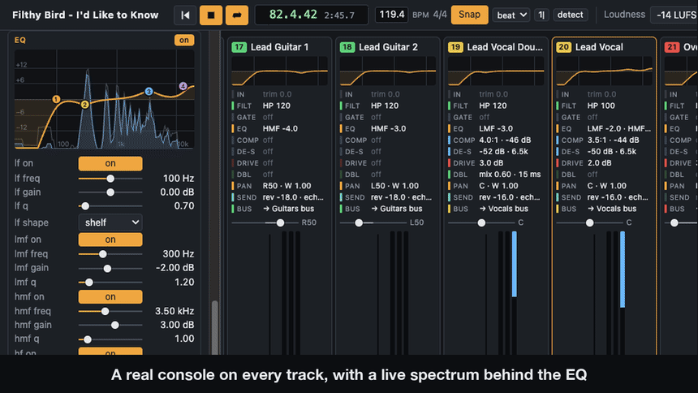
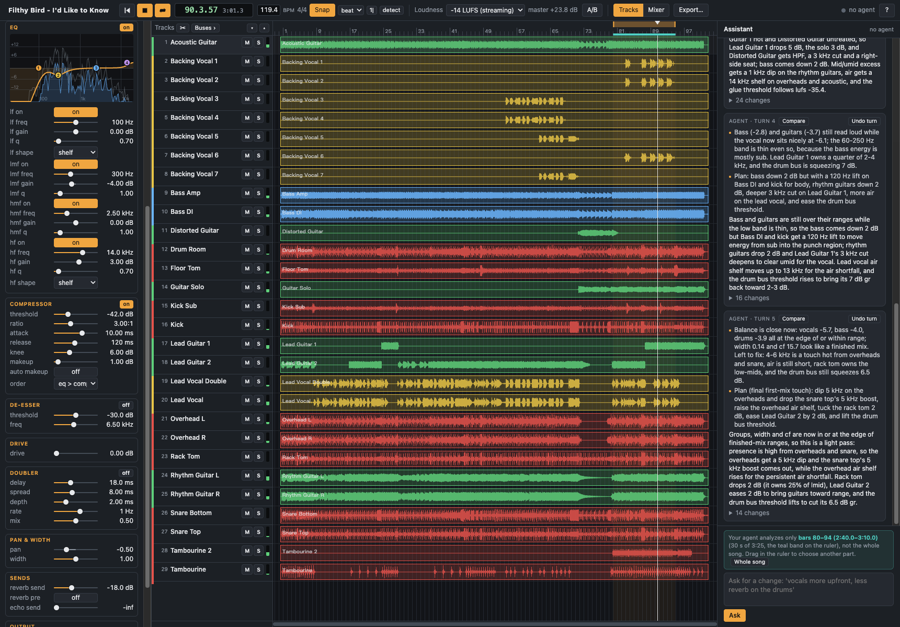

# mix_final_ACTUAL.wav

<p align="center"></p>

**Your coding agent mixes your multitrack, on a real mixing console that runs in your browser.**
Give Claude Code or Codex a folder of tracks. It mixes them on the console in five turns, reading the console's
measurements each turn. Then you keep going: move faders, edit clips, or type what you want changed in plain words.
Everything runs on your machine. There are no API keys, nothing to set up, and your audio never leaves your computer.

## Install

You need [Claude Code](https://claude.com/claude-code) or [Codex](https://openai.com/codex), signed in as usual.
The plugin includes the console as a ready-made program for macOS (Apple silicon and Intel), Windows (x64) and Linux
(x64 and arm64). There's nothing else to install.

**Claude Code**: in a Claude Code session:
```
/plugin marketplace add barry-mir/mix-final-actual
/plugin install mix-final-actual@mix-final-actual
```
Then restart Claude Code.

**Codex**:
```
codex plugin marketplace add barry-mir/mix-final-actual
```
Then install `mix-final-actual` from the plugin list (`/plugins`).

## Demo

https://github.com/user-attachments/assets/383375f1-0a0a-42a0-a03a-89549ae862ad

<p align="center"><sub>30 seconds, with sound: the same passage switches between the raw tracks (black and white) and
the mix (colour), then the features. Song: Filthy Bird, "I'd Like to Know", from MedleyDB: 29 raw tracks mixed by
Claude Code through this plugin in about three minutes. If the player doesn't show,
<a href="docs/media/demo.mp4">open the video file</a>.</sub></p>

## Features

<p align="center"></p>

**Mixed by your agent**
- Your agent mixes on a real DSP console, not by guessing at presets. Every turn the console analyzes the music and
  sends your agent a measurement report: levels, dynamics, stereo width, tone in eight bands, which track owns each
  band, and how all of that compares with finished professional mixes. Your agent answers with console moves.
- **First mix in five turns.** Turn 1 builds the whole mix; turns 2 to 5 read what the earlier moves did and fix what
  the measurements flag.
- **Ask in plain words**, from the page or the chat: "vocals more upfront", "less reverb on the drums". Each answer
  shows the agent's notes while it works, its reply, and every change it made, with **Compare** (hear the mix before
  that turn) and **Undo turn**.
- **No agent open? It starts one.** If you type a request while your agent is closed or busy, the console starts your
  Claude Code or Codex in the background with only the mixing tools, on your own login.
- **It analyzes silently, and you choose what it hears.** The agent analyzes the bars you select, marked in teal on the
  timeline, or the whole song, offline and without playing anything.

**A real console**
- Per track: trim, polarity, high and low cut, gate, four-band EQ, compressor, de-esser, drive, doubler, pan and
  width, reverb and echo sends.
- Five instrument-group buses (vocals, drums, bass, guitars, keys & other), each with a compressor and a peak clipper.
  The master has reverb and echo returns, a glue compressor and a true-peak limiter.
- Every strip shows its EQ curve and a one-line summary of each processing block, plus input, output and
  gain-reduction meters. The EQ editor draws a live spectrum of the track behind the curve.

**A DAW around it**
- Tracks view with waveforms: move, trim, fade, split (scissors or at the playhead), cut, copy and paste between
  tracks with automatic crossfades, and a clip gain handle on every clip.
- The tempo is detected from the drums. The timeline shows bars and beats, with snap to the grid.
- Mixer view, an inspector for every track, bus and return, undo and redo, and the usual DAW shortcuts (press `?` in
  the page).
- **What you hear is what you export.** Playback runs at the loudness you export at (−14 LUFS for streaming by
  default). **A/B** switches instantly between the raw tracks and your mix at matched loudness.
- Export to 24-bit WAV or FLAC, optionally with one stem per track, wherever you choose.

<p align="center"></p>

## How well does it mix?

We measured the same console and five-turn method on the 21 MedleyDB songs that have no bleed between tracks. The
metric is KAD on FxEncoder++ embeddings, which measures how far each system's mixes are, as a set, from the original
engineers' mixes of the same songs. Lower is closer.

| System | KAD (FxEncoder++) ×100 ↓ | 95% CI |
|---|---:|---|
| Raw tracks, summed | 28.7 | 24.9 – 38.3 |
| FxNorm | 45.0 | 41.2 – 54.9 |
| Rule-based mix | 29.9 | 25.8 – 39.4 |
| Rule-based mix + measurement flags (no LLM) | 19.1 | 15.9 – 27.1 |
| DMC (Differentiable Mixing Console) | 13.4 | 11.0 – 21.6 |
| MEGAMI | 10.8 | 9.7 – 18.3 |
| **This console + Claude Opus 5.5** | **8.0** | 7.2 – 13.9 |
| **This console + Claude Sonnet 5.5** | **7.0** | 6.1 – 13.3 |
| **This console + Claude Haiku 5.5** | **7.0** | 6.3 – 12.9 |
| *Original mix against itself (the floor)* | *−0.7* | |

- All three Claude models score lower (better) than every other system, though their confidence intervals overlap
  MEGAMI's and DMC's.
- The smallest model scores as well as the largest here.
- How it was scored:
  - Mixes are loudness-matched to −23 LUFS, and 105 segments are taken per system.
  - The reference is each song's original engineered stems summed, without mastering.
  - The confidence intervals come from a bootstrap over songs.
- The runs used the research harness with the same console, prompt and five turns, mixing a 30-second excerpt.

## Use

1. **Name your tracks.** Put one audio file per track in a folder, named by instrument: `Lead Vocal.wav`, `Kick.wav`,
   `Bass DI.wav`, `Overheads.wav`. WAV, AIFF, FLAC and Ogg work everywhere (MP3 and M4A on macOS too), at any sample
   rate. Your agent mixes by these names. With names like `Audio 01.wav` it will ask you what each track is.
2. **Ask your agent** in Claude Code or Codex:
   > mix the tracks in ~/Music/my-song

   It makes the first mix (five turns, a few minutes), then the mixer page opens in your browser.
3. **Listen and adjust.** Press Space to play. Move faders, open a track's controls, edit clips, and use A/B against
   the raw tracks.
4. **Ask for changes**, in the page ("make the chorus vocals wider") or in the chat. To change what the agent analyzes,
   drag in the ruler to select other bars, or choose **Whole song**.
5. **Export** with the Export button (Cmd/Ctrl+B): pick the file, WAV or FLAC, the loudness, and stems if you want
   them.

**Coming back later.** The project saves itself every 10 seconds into `mix_final_ACTUAL project.json` next to your
tracks; your audio files are never changed. To reopen a mix, ask your agent ("open my *song* mix") or click the title
in the page for your recent projects. The mixer keeps running when you close the page or your agent; a request you
type still gets answered, because the console starts the agent.

## Good to know

- **Privacy:** the page and the agent's tools only answer on your own computer (127.0.0.1), with a new random key
  each time the console starts. Nothing is uploaded except what your coding agent itself sends to its model: the text
  measurement reports, your track names and your requests, never audio.
- **The agent analyzes a section, not always the whole song.** By default that's a 30-second excerpt where every
  instrument plays, shown in teal on the ruler. Choose the section that matters, or **Whole song** (slower turns).
- **Stop** on a running turn ends it with nothing changed. **Undo turn** takes back any finished turn.
- **Files** (per user: `~/Library/Application Support/mix-final-actual` on macOS, `~/.config/mix-final-actual` on
  Linux, `%APPDATA%\mix-final-actual` on Windows):
  - `logs/`: the console's log, and the logs of any agent it started.
  - `turns/`: each turn's measurement report.
  - `cache/`: converted copies of tracks in other formats or sample rates; safe to delete.
- **Turn off automatic agents:** set `MFA_AUTO_AGENT=0` in the environment.

**Troubleshooting**
- *"No coding agent is listening"* and nothing starts: make sure `claude` or `codex` works in a terminal, or tell your
  agent "keep answering the mixer".
- *The link says it's out of date:* the console was restarted, and each start makes a new link. Ask your agent to open
  the mix again; it gives you the new link.
- *Start a mix over:* ask your agent for a new mix of the folder, or delete `mix_final_ACTUAL project.json`.

## Credits and licence

- **Licence:** AGPLv3. Built with [JUCE](https://juce.com) 8 (AGPLv3), [cpp-httplib](https://github.com/yhirose/cpp-httplib)
  and [nlohmann/json](https://github.com/nlohmann/json).
- **Demo audio:** Filthy Bird, "I'd Like to Know", from [MedleyDB](https://medleydb.weebly.com/) (R. Bittner et al., ISMIR
  2014 and 2016), used under its Creative Commons Attribution-NonCommercial-ShareAlike licence. The demo video and
  screenshot are shared under the same terms.
- Another full example run, a 21-track band: [docs/examples/pocket-knife.md](docs/examples/pocket-knife.md).

## Building from source (contributors)

Plugin users can skip this.

```sh
cmake -S . -B build -G Ninja -DCMAKE_BUILD_TYPE=Release
cmake --build build
./build/mix-final-actual_artefacts/Release/mix-final-actual serve path/to/tracks   # --no-first-mix to mix by hand
```
- `mix-final-actual mcp` is the MCP server the plugin registers.
- On Linux you also need: `build-essential cmake ninja-build libasound2-dev libfreetype-dev libfontconfig1-dev libx11-dev
  libxrandr-dev libxinerama-dev libxcursor-dev libxext-dev libxcomposite-dev libgl1-mesa-dev`.
- Design notes: [docs/DESIGN.md](docs/DESIGN.md) and [docs/DAW_DESIGN.md](docs/DAW_DESIGN.md).
