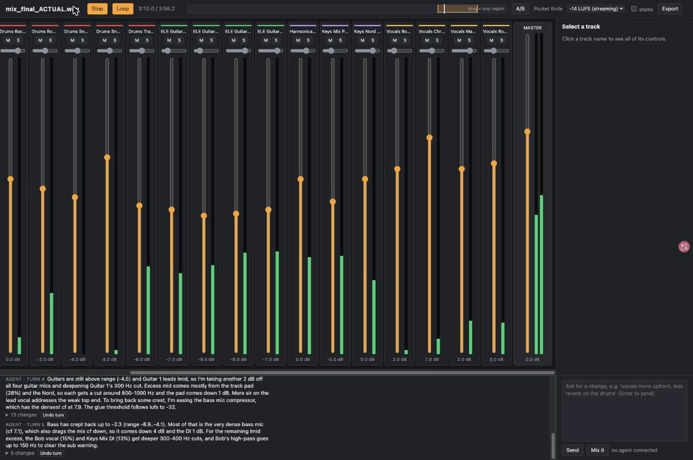

# Example run: "Pocket Knife" (Bronze Radio Return)

A real run of the plugin, start to finish, on 2026-10-18: Claude Code with Opus, the plugin loaded with
`--plugin-dir`, macOS. The input was the multitrack of "Pocket Knife" by Bronze Radio Return as handed out for the latest reaMIXed contest
(21 WAV files, 3:56). The audio is not in this repo; the stems are not ours to redistribute.

## What was asked

```
claude -p "Mix the tracks in <folder>/Pocket Knife . Do the first mix (all turns). When the first mix is done and
the session is live, do not wait for page prompts: stop and tell me what the mix does in a few sentences." \
  --plugin-dir mix-final-actual --model opus
```

The file names were used as they came (`Vocals-Chris-M80.wav`, `Drums-Kick In-M82.wav`, ...). The console picked the
30 s excerpt at 3:05-3:35, where every instrument group plays, and the coding agent mixed it in five turns.

## Time and cost

| | |
|---|---|
| Wall time, first mix (5 turns) | 2 min 18 s |
| Claude Code cost (Opus) | $1.57 |
| Changes per turn | 211, 17, 16, 13, 5 |
| Export (whole song + 3 s tail, 24-bit WAV) | -14.0 LUFS |

## What the agent did, turn by turn

Each turn the console played the excerpt, measured it and sent the measurements; these are the agent's own words
(shown in the page's chat, each turn with its list of changes and an Undo button).

**Turn 1** (211 changes)

> Intent: Live roots/blues-rock band recording (two electric guitars, harmonica, keys, four singers, full kit plus a track pad). Focal element is the lead vocal (Chris), with the three other voices as harmonies spread around it. Drums and bass drive it, so they should be punchy but not boomy. The guitars go wide L/R, keys and harmonica fill the gaps, and the overall tone should be open and bright with a natural room.
> Moves: pull the over-loud bass down and control it; carve 200-500 Hz mud from guitars/keys/toms; high-pass everything non-bass; add attack to kick/snare and air to overheads and vocals; pan guitars hard, keys/harmonica/toms/BVs off-centre; compress the vocals and add reverb/echo; glue the drum and vocal buses and the master.

**Turn 2** (17 changes)

> The guitars are far too loud (-4.3 dB against a -12.3..-5.7 range) and are what make lmid too strong and the mix too wide (sw 0.44). The vocals (-13.3) and drums (-12.3) sit well under their ranges. Pull the guitars down about 4 dB and bring their pans in to ±0.65. Return the overhead and room width to 1.0. Raise the lead vocal by 4 dB and the harmonies by 2 dB, and lift the kick and snare. Re-derive the glue threshold from lufs -31.7 so it actually engages.

**Turn 3** (16 changes)

> The groups are close now. Keys/other (-6.5) and guitars (-5.2) still sit slightly hot, and Keys Mix DI dominates lmid and mid, so I'm pulling it down 3 dB and the guitars 1 dB. The harmony vocals get a 300 Hz cut to reduce the remaining lmid. To fix the excess width (sw 0.22), I'm lowering the track pad's doubler mix and narrowing the keys DI. For the missing brilliance and air, I'm adding a high shelf on the overheads and track pad. Finally, the glue threshold comes down to lufs+4 (-31).

**Turn 4** (13 changes)

> Guitars are still above range (-4.5) and Guitar 1 leads lmid, so I'm taking another 2 dB off all four guitar mics and deepening Guitar 1's 300 Hz cut. Excess mid comes mostly from the track pad (28%) and the Nord, so each gets a cut around 800-1000 Hz and the pad comes down 1 dB. More air on the lead vocal addresses the weak top end. To bring back some crest, I'm easing the bass mic compressor, which has the densest cf at 7.9. The glue threshold follows lufs to -32.

**Turn 5** (5 changes)

> Bass has crept back up to -2.3 (range -8.9..-4.1). Most of that is the very dense bass mic (cf 7.1), which also drags the mix cf down, so it comes down 4 dB and the DI 1 dB. For the remaining lmid excess, the Bob vocal (15%) and Keys Mix DI (13%) get deeper 300-400 Hz cuts, and Bob's high-pass goes up to 150 Hz to clear the sub warning.

## How the measurements moved

From the console's report at the start of each turn (the comparison is with statistics over finished professional
mixes; "cf" is crest factor, "sw" stereo width):

| Turn | Flags against finished mixes |
|---|---|
| 1 (raw tracks) | sub +2.4, low +3.1, low-mid +2.5, mid +2.5 too strong; presence -4.8, brilliance -7.9, air -12.4 too weak; over-compressed; too narrow (sw 0.01) |
| 2 | low-mid +4.4, mid +3.2 too strong; presence -5.5, brilliance -10.3, air -14.5 too weak; over-compressed; too wide (sw 0.44) |
| 3 | low +2.4, low-mid +4.0 too strong; brilliance -5.9, air -13.1 too weak; over-compressed; too wide (sw 0.22) |
| 4 | low-mid +3.5, mid +4.2 too strong; presence -3.6, brilliance -8.5, air -12.0 too weak; over-compressed |
| 5 | low-mid +3.5 too strong; brilliance -6.6, air -11.2 too weak; over-compressed |

The flags go from nine to four, and stereo width settles inside the range of finished mixes. Low-mid excess and the
missing top end remain; the agent said so in its report rather than claiming a finished master.

## The agent's report

> I mixed it as a live roots/blues-rock band, with Chris as the lead vocal in the centre and on top. Bob, Matt and Rob
> are the harmonies, spread left and right with reverb behind them. The two guitars sit opposite each other at about
> ±0.65, and the two keys parts and the harmonica fill the gaps between. Kick, snare and bass stay centred. Kick and
> snare have extra attack, and the drum and vocal buses have light compression to hold them steady. Most of the work
> after the first turn was rebalancing: the guitars came down about 7 dB, the bass was cut back twice, and I carved
> low-mids out of the guitars, keys and harmony vocals.

## The page afterwards



## Known issue seen in this run

The agent balanced the groups by turning the loud ones down and never brought the whole mix back up: the playing mix
went from -25.6 to -37.2 LUFS over the five turns. Exports are unaffected (they are mastered to the chosen
loudness, here -14.0 LUFS), but the live page plays quietly.
